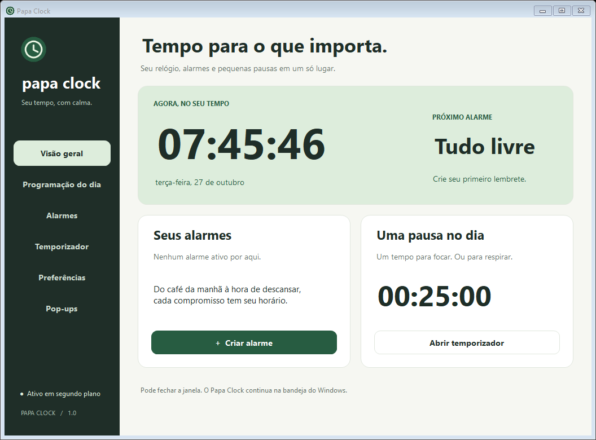
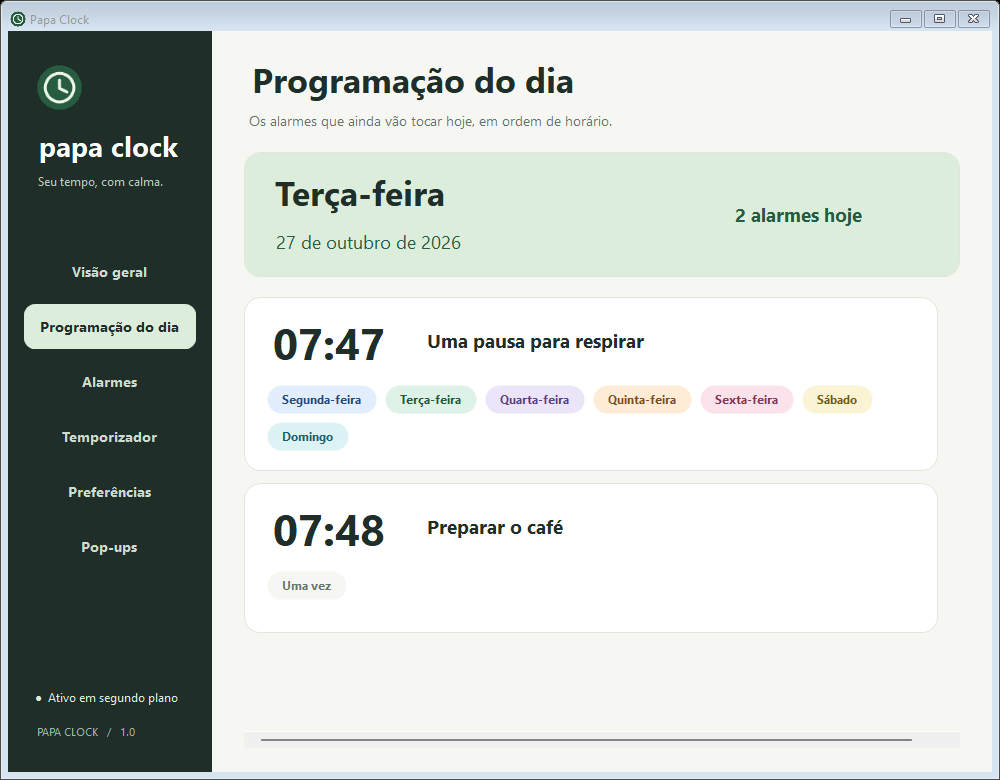
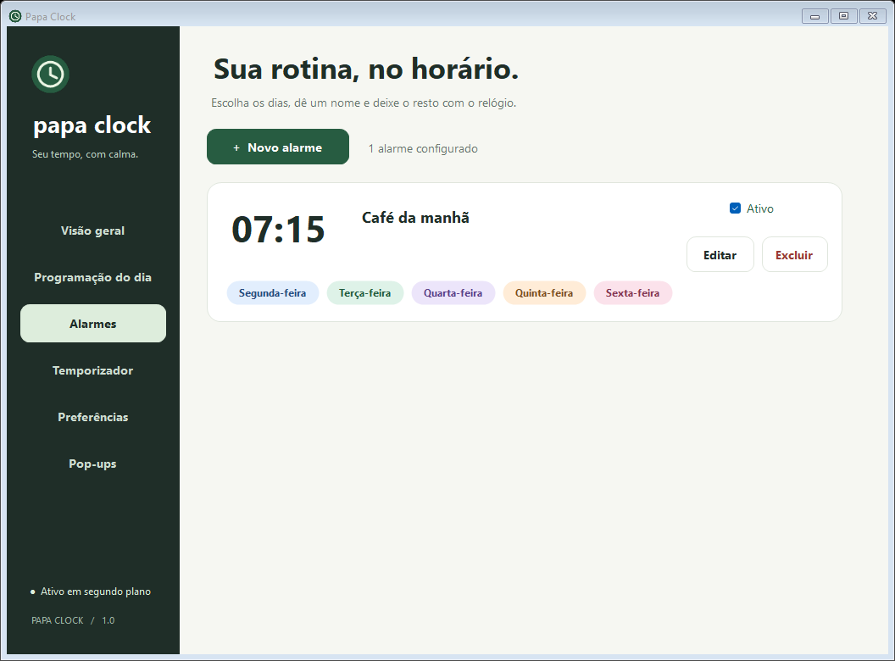
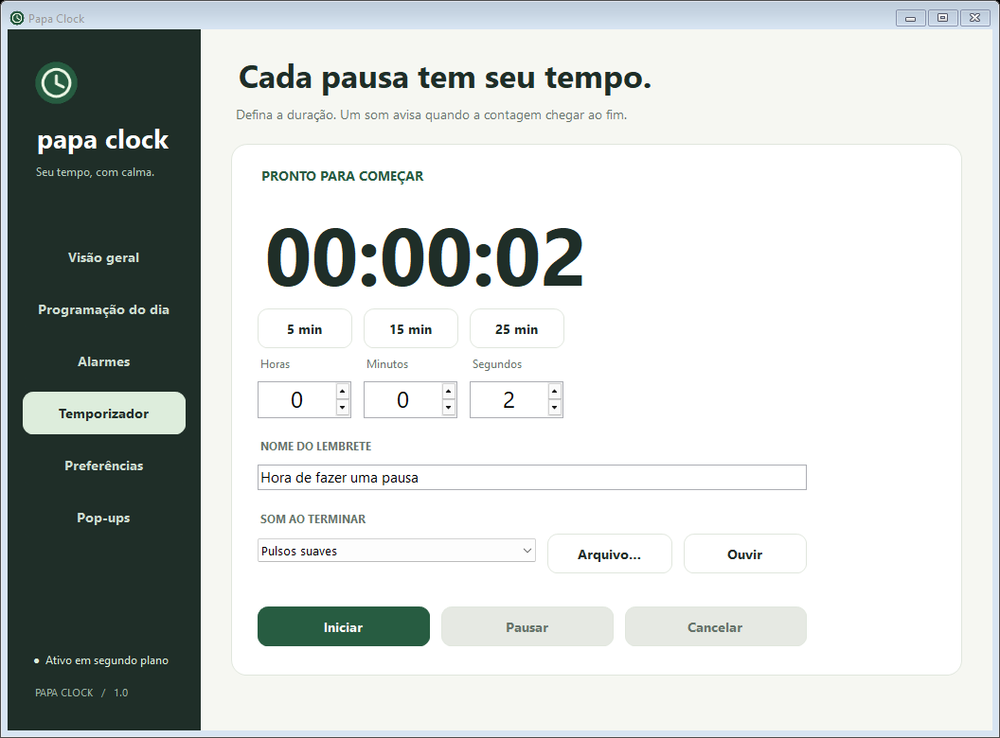
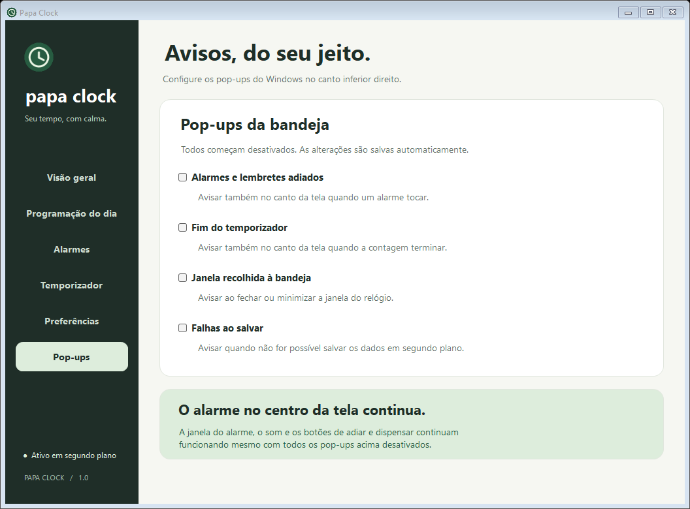
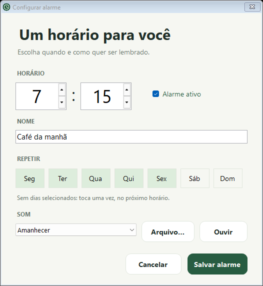

# Papa Clock

**Seu tempo, com calma.** Um relógio para Windows que reúne alarmes, programação diária e temporizador em uma interface simples, em português.

O Papa Clock continua funcionando na bandeja do sistema quando a janela é fechada. Seus dados ficam no próprio computador, sem necessidade de conta ou conexão com a internet.



## O que você pode fazer

- **Criar alarmes:** escolha horário, nome, dias da semana e som. Um alarme sem dias selecionados toca uma única vez, no próximo horário.
- **Consultar a programação do dia:** veja a data e os alarmes ativos que ainda vão tocar hoje, em ordem de horário. Cada dia da semana aparece em uma etiqueta de cor própria.
- **Usar o temporizador:** configure até 99 horas, 59 minutos e 59 segundos; pause, retome ou cancele a contagem. Há atalhos de 5, 15 e 25 minutos.
- **Escolher sons:** use sons do Windows ou um arquivo WAV do computador e ouça uma prévia antes de salvar.
- **Adiar ou dispensar:** ao tocar, uma janela aparece no centro da tela, com opções para dispensar ou adiar por cinco minutos.
- **Continuar na bandeja:** fechar ou minimizar a janela mantém o aplicativo em segundo plano. É possível ativar a inicialização com o Windows.
- **Configurar pop-ups:** escolha quais avisos do canto inferior direito deseja receber. Todos vêm desativados; a janela central e o som dos alarmes continuam funcionando.

## Telas

As imagens abaixo foram capturadas do aplicativo com alarmes de exemplo.

| Programação do dia | Alarmes |
|:---:|:---:|
|  |  |

| Temporizador | Pop-ups |
|:---:|:---:|
|  |  |

<details>
<summary>Ver a tela de configuração de um alarme</summary>



</details>

## Começar

### Requisitos

- Windows com .NET Framework 4.8 e o compilador C# do .NET Framework disponível.
- PowerShell para compilar e instalar a partir do código-fonte.
- Áudio habilitado para ouvir os alarmes. Não são necessários Python, Node.js ou pacotes de terceiros.

### Compilar e instalar

Clone o repositório e execute os comandos no PowerShell:

```powershell
git clone https://github.com/thalyson004/papa-clock.git
cd papa-clock
.\build.ps1
.\install.ps1 -Launch
```

A compilação gera `bin\PapaClock.exe`; esse arquivo também pode ser aberto diretamente. O instalador copia o aplicativo para `%LOCALAPPDATA%\Programs\PapaClock` e cria atalhos na Área de Trabalho e no menu Iniciar, sem exigir permissões de administrador. A pasta `bin` é gerada localmente e não faz parte do repositório.

Em **Preferências**, marque **Iniciar com o Windows** para iniciar o aplicativo na bandeja ao entrar no seu usuário. Também é possível instalar com essa opção usando `.\install.ps1 -StartWithWindows -Launch`.

### Usar a bandeja

Ao fechar ou minimizar a janela, procure o ícone do Papa Clock perto do relógio do Windows, inclusive na área da setinha `^`. Dê dois cliques no ícone para abrir a janela; clique com o botão direito para acessar as ações rápidas e **Sair do Papa Clock**.

## Como os avisos funcionam

O computador precisa estar **ligado e acordado**, com o aplicativo em execução e o áudio habilitado. O Papa Clock não desperta o Windows da suspensão. Se você escolher **Sair**, encerrar a sessão ou desligar o computador, os avisos só poderão ser emitidos depois que o aplicativo voltar a executar.

Ao retomar ou reabrir o aplicativo, alarmes com até 10 minutos de atraso são recuperados; os mais antigos são ignorados. Uma contagem em andamento usa um prazo real e avisa ao voltar a executar, mesmo que esse prazo já tenha passado. Uma contagem pausada continua pausada. Avisos ainda não dispensados e lembretes adiados também são restaurados.

Os alarmes seguem a hora local do Windows. O temporizador usa o relógio UTC do sistema; ajustes manuais nesse relógio podem afetar a duração da contagem. Arquivos WAV personalizados são referenciados pelo caminho original: mantenha-os no mesmo local. Se um arquivo não estiver disponível, o aplicativo usa o som padrão.

## Dados e privacidade

Os alarmes, o temporizador e as preferências ficam em `%LOCALAPPDATA%\PapaClock\settings.json`. O aplicativo usa gravação atômica e mantém uma cópia anterior em `settings.json.bak`. Se houver corrupção, ele preserva o arquivo original e tenta recuperar a cópia, avisando o usuário. A pasta pode ser aberta pela tela **Preferências**.

Os dados locais, backups e capturas geradas durante os testes não são incluídos no repositório. As imagens exibidas neste README são exemplos selecionados para apresentação.

## Desenvolvimento

O projeto usa C# e Windows Forms, com bibliotecas do .NET Framework. O script de compilação usa o compilador do próprio Framework.

```powershell
.\build.ps1          # compila o aplicativo
.\build.ps1 -Test    # compila e executa os testes de lógica
.\build.ps1 -GuiTest # compila e executa os testes de interface
```

Os testes de lógica cobrem agendamento, persistência e recuperação. Os testes de interface abrem janelas reais em uma pasta de dados temporária, usam áudio silenciado e geram capturas em `artifacts`. Eles não verificam fisicamente os alto-falantes.

```text
src/         Código do aplicativo, interface, áudio e agendamento
tests/       Testes de lógica e de interface
assets/      Manifesto e ícone do aplicativo
docs/images/ Capturas usadas neste README
build.ps1    Compilação e testes
install.ps1  Instalação para o usuário atual
```

## Remover

Saia pelo ícone da bandeja, desmarque **Iniciar com o Windows** e exclua `%LOCALAPPDATA%\Programs\PapaClock` e os atalhos **Papa Clock**. Para apagar também os dados e as configurações, exclua `%LOCALAPPDATA%\PapaClock` separadamente.
